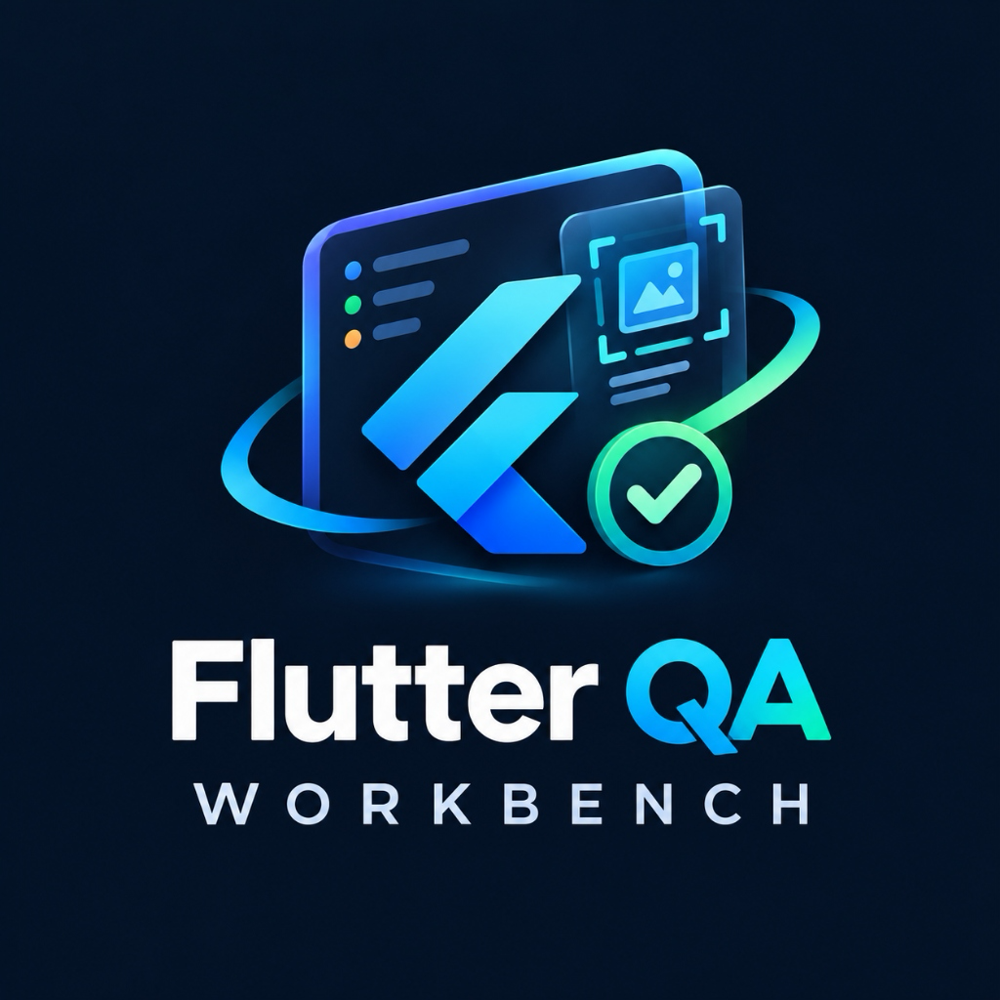

<p align="center">
  
</p>

# Flutter QA Workbench 🛡️

**Flutter QA Workbench** is a professional, high-performance developer tool suite for Flutter applications. It combines static analysis, accessibility (a11y) auditing, layout validation, responsiveness heuristics, and deep IDE integration into an intuitive workflow.

---

## 🌟 Key Features

- **Accessibility (a11y) Engine**:
  - Detects icon buttons lacking descriptive tooltips (`QA001`).
  - Flags interactive touch targets (`GestureDetector`, `InkWell`) missing semantic labels (`QA002`).
  - Warns on non-decorative images without `semanticLabel` (`QA003`).
  - Identifies `ExcludeSemantics` widgets that hide interactive subtrees (`QA004`).

- **Layout & Responsiveness Auditing**:
  - Flags unbounded columns and rows nested inside scrollable viewports (`QA101`).
  - Detects improper usage of `Expanded` / `Flexible` inside scroll views (`QA102`).
  - Identifies anti-pattern deep nesting (> 12 levels) (`QA103`).
  - Warns on large hardcoded pixel dimensions (> 300px) that degrade responsiveness (`QA104`).

- **Multi-Format Reporting**:
  - **Terminal Table**: Rich human-readable feedback.
  - **JSON**: Structured machine-readable schema for automated tooling.
  - **SARIF**: Static Analysis Results Interchange Format for native integration with GitHub Code Scanning.

- **VS Code Extension Integration**:
  - Native Activity Bar view with a custom Webview dashboard.
  - Real-time diagnostic markers mapped directly to source code lines.
  - Interactive search, severity filtering, category toggles, and direct file jump navigation.
  - Auto-scan on Dart file save with configurable debouncing.
  - One-click SARIF and JSON export.

---

## 🏗️ Repository Architecture

```
flutter_qa_workbench/
├── packages/
│   └── qa_core/                 # High-performance Dart static analysis engine & CLI
│       ├── bin/cli.dart         # Command-line entry point
│       ├── lib/                 # Core engine, rules, config, models, reporters
│       └── test/                # Comprehensive unit & integration test suite (59 tests)
├── integrations/
│   └── vscode/                  # VS Code Extension
│       ├── src/dart_process.ts  # CLI process lifecycle & VS Code diagnostics bridge
│       ├── src/extension.ts     # Extension entry point, commands, auto-scan
│       └── src/webview_provider.ts # Custom dashboard UI (HTML/CSS/JS)
└── example/                     # Deliberate QA test fixture Flutter project
```

---

## 🚀 Quick Start

### 1. CLI Usage

From `packages/qa_core`:

```bash
# Analyze any Flutter workspace
dart run bin/cli.dart --project /path/to/flutter_app

# Generate a SARIF report
dart run bin/cli.dart --project /path/to/flutter_app --format sarif --output report.sarif

# Output machine-readable JSON
dart run bin/cli.dart --project /path/to/flutter_app --format json
```

### 2. VS Code Extension

Package and install the extension:

```bash
cd integrations/vscode
npm run compile
npx @vscode/vsce package --no-dependencies
code --install-extension flutter-qa-workbench-0.1.0.vsix
```

### 3. Running Tests

To verify the test suite (59 unit and integration tests):

```bash
cd packages/qa_core
dart test
```

---

## ⚙️ Configuration (`qa_workbench.yaml`)

Customize rule severity or disable rules project-wide:

```yaml
rules:
  QA001:
    enabled: true
    severity: warning
  QA101:
    enabled: true
    severity: error
  QA104:
    enabled: false

exclude:
  - "lib/generated/**"
  - "**/*.g.dart"
```

---

## 🧑‍💻 Author & Maintainer

* **Developer**: [Vaibhav Ghadge](https://www.linkedin.com/in/vaibhav-ghadge-315841168/)
* **Publisher**: **VroyCLe**
* **LinkedIn**: [https://www.linkedin.com/in/vaibhav-ghadge-315841168/](https://www.linkedin.com/in/vaibhav-ghadge-315841168/)

---

## 📄 License

This project is licensed under the [MIT License](LICENSE).
